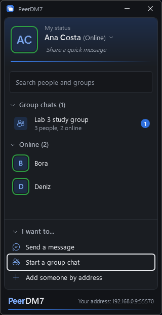
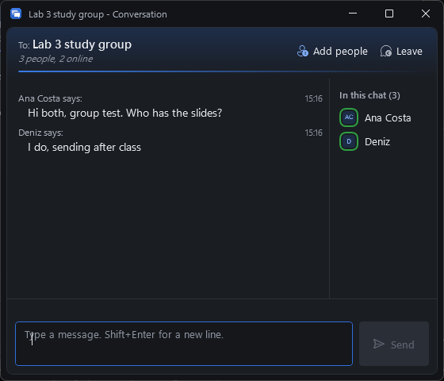

<p align="center">
  
</p>

<h1 align="center">PeerDM7</h1>

<p align="center">
  A small, serverless LAN messenger for Windows, in the spirit of MSN Messenger.<br>
  One portable .exe. No account, no server, no admin rights.
</p>

<p align="center">
  <a href="https://github.com/SeventhSG/PeerDM7/releases/latest"><b>Download PeerDM7.exe</b></a>
</p>

<p align="center">
  
  &nbsp;
  
</p>

## What it does

- **Finds people by itself.** Everyone running PeerDM7 on the same Wi-Fi or LAN shows up in your list within a few seconds.
- **Direct messages** in a classic conversation window: "Name says:", display pictures, typing indicator.
- **Group chats up to 20 people.** Pick people, name the group, and everyone gets it. Anyone in the group can add more people or leave.
- **Nudges.** Shake someone's chat window. It still works.
- **Status and a personal message** (Online, Away, Busy) shown next to your name.
- **Pop-up notifications** in the corner and a flashing taskbar button when a message arrives.
- **Add by address** for someone on a different subnet: type their IP, shown at the bottom of their window.
- Follows the Windows light or dark theme.

## Nothing is saved

Sign-in is just a username. Your name, your contacts, every message and every group live in memory only.
Close PeerDM7 (tray icon, **Sign out and quit**) and all of it is gone. Nothing is written to disk.

## Getting started

1. Download `PeerDM7.exe` from the [latest release](https://github.com/SeventhSG/PeerDM7/releases/latest).
2. Double-click it. There is no installer. It runs as your normal user, so admin rights are never needed.
3. Type a username and press **Sign in**.
4. Ask a friend on the same network to do the same. Double-click their name to chat.

Closing the contact list keeps you online in the system tray. Right-click the tray icon to quit.

> Windows SmartScreen may warn about an unrecognised app because the exe is not code-signed.
> Choose **More info**, then **Run anyway**.

### The firewall prompt

The first time PeerDM7 starts, Windows Firewall may ask whether to allow it on the network.

- If you can, allow it on **private networks**.
- If you cannot (no admin rights), choose **Cancel**. PeerDM7 still works as long as the other person's PC accepts connections:
  your copy announces itself, theirs answers, and yours dials out to them. Two PCs that both block incoming connections cannot reach each other.

## How it works

| Part | Detail |
| --- | --- |
| Discovery | UDP broadcast on port `47007` every 5 seconds. Peers answer with a unicast reply, which Windows Firewall lets through by default. |
| Transport | One TCP connection per pair of people, port `47007` (or a free port if that one is taken). |
| Encryption | Each session starts with an ECDH P-256 key exchange, signed with a per-session identity key. Messages are AES-256-GCM. A person's ID is a hash of their identity key, so a name can be copied but an ID cannot. |
| Groups | Full mesh: every message goes straight to each member. Membership changes carry a version number, and the newest version wins on every PC. |
| Delivery | Messages to someone whose connection drops are queued and resent if they come back while you are still signed in. Group messages show "Delivered to N of M". |

Identity keys are created fresh each time you sign in. That is what makes chats disappear for real: after a restart you are a new person to everyone else.

## Building from source

Requires the [.NET 10 SDK](https://dotnet.microsoft.com/download) on Windows.

```powershell
git clone https://github.com/SeventhSG/PeerDM7.git
cd PeerDM7
dotnet run --project src/PeerDM7

# Single portable exe, written to .\publish
dotnet publish src/PeerDM7/PeerDM7.csproj -c Release -o publish
```

Handy flags while developing:

| Flag | Effect |
| --- | --- |
| `--name "Ana"` | Skip the sign-in screen |
| `--quiet` | No notification sounds |
| `--log path.txt` | Write a diagnostic log to that file |

Several copies can run on one PC for testing; each gets its own port.

## Project layout

```
src/PeerDM7/
  Core/         message and group models, session identity
  Net/          discovery, encrypted sessions, connection management
  ViewModels/   contact list, conversations, group sync
  Views/        sign-in, contact list, chat, people picker, toast
  Themes/       light and dark tokens, control styles
```

## Known limits in v0.1.0

- Messages are delivered only while both people are signed in. There is no offline storage, by design.
- No file transfer, emoticons or chat history yet.
- PCs on different subnets need to be added by address; broadcasts do not cross routers.
- Windows 10 and 11, x64.

## License

[MIT](LICENSE), by [SeventhSG](https://github.com/SeventhSG).
