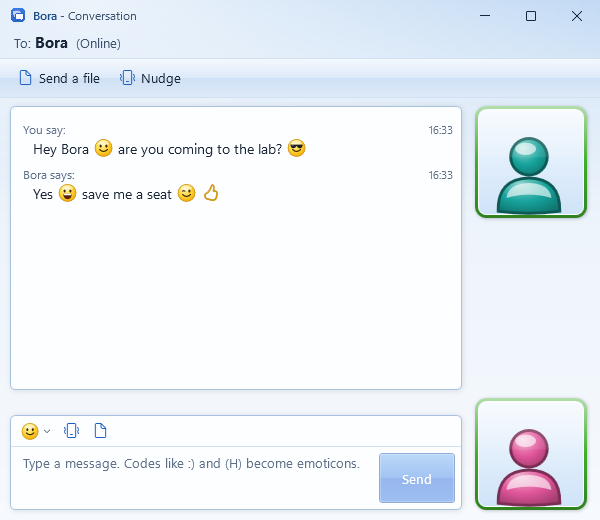
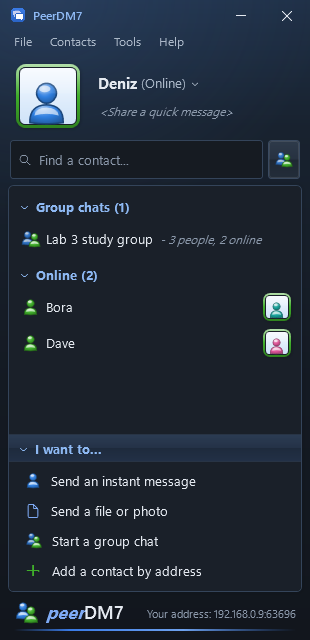
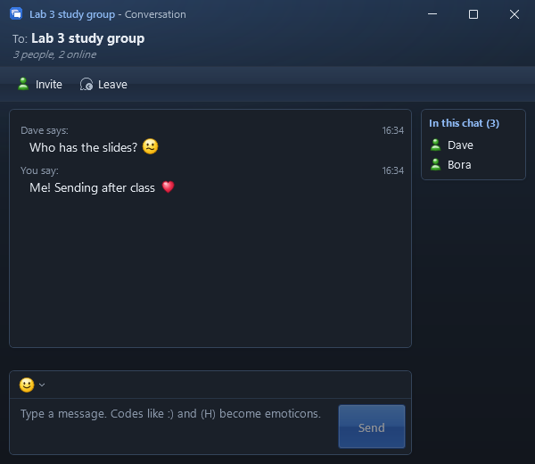

<p align="center">
  
</p>

<h1 align="center">PeerDM7</h1>

<p align="center">
  A small, serverless LAN messenger for Windows, in the spirit of MSN Messenger.<br>
  One portable .exe. No account, no server, no admin rights.
</p>

<p align="center">
  <a href="https://github.com/SeventhSG/PeerDM7/releases/latest"><b>Download PeerDM7.exe</b></a>
</p>

<p align="center">
  
  &nbsp;
  
</p>
<p align="center">
  
  &nbsp;
  
</p>

## What it does

- **Finds people by itself.** Everyone running PeerDM7 on the same Wi-Fi or LAN shows up in your list within a few seconds.
- **Direct messages** in a classic conversation window: "Name says:", both display pictures on the right, typing indicator.
- **Emoticons.** Type the old codes, `:)` `:D` `;)` `:P` `:(` `:'(` `:@` `:O` `:S` `:$` `(H)` `8-|` `|-)` `+o(` `(A)` `(6)` `:-*` `(L)` `(U)` `(*)` `(Y)` `(N)`, or pick them from the smiley menu.
- **Display pictures.** Built-in aero guys in eight colours, or any picture of your own. Everyone sees it next to your name.
- **Send files and photos** up to 2 GB, with accept or decline, a progress bar, and a SHA-256 check. Files land in your Downloads folder.
- **Group chats up to 20 people.** Pick people, name the group, and everyone gets it. Anyone in the group can invite more people or leave.
- **Nudges.** Shake someone's chat window. It still works.
- **No spamming.** Five messages in a burst, then one every 1.2 seconds, and one nudge per 15 seconds. The same limits apply to what you receive, so a modified copy cannot flood you either.
- **Status and a personal message** (Online, Away, Busy) shown next to your name.
- **Pop-up notifications** in the corner and a flashing taskbar button when a message arrives.
- **Add by address** for someone on a different subnet: type their IP, shown at the bottom of their window.
- **White or dark theme**, under Tools.

## Nothing is saved

Sign-in is just a username. Your name, picture, contacts, every message and every group live in memory only.
Close PeerDM7 (tray icon, **Sign out and quit**) and all of it is gone. The only thing PeerDM7 ever writes to disk
is a file you choose to accept, saved to your Downloads folder.

## Getting started

1. Download `PeerDM7.exe` from the [latest release](https://github.com/SeventhSG/PeerDM7/releases/latest).
2. Double-click it. There is no installer. It runs as your normal user, so admin rights are never needed.
3. Type a username and press **Sign in**.
4. Ask a friend on the same network to do the same. Double-click their name to chat.

Closing the contact list keeps you online in the system tray. Right-click the tray icon to quit.

> Windows SmartScreen may warn about an unrecognised app because the exe is not code-signed.
> Choose **More info**, then **Run anyway**.

### No admin, no firewall setup

PeerDM7 is built for PCs where you cannot change anything, like school or library computers on a **Public** network.

- If Windows asks "Do you want to allow public and private networks to access this app?", press **Cancel**. You do not need to allow it.
- PeerDM7 never waits for incoming connections. Every copy sends small packets to the other PCs on its subnet, and Windows Firewall
  treats the other side's packets as replies to that traffic. That works the same on Public and Private networks.

What it cannot get around: some Wi-Fi networks stop devices from talking to each other at all (client isolation).
Wired lab PCs usually do not do this. If people never show up on a Wi-Fi network, that is the likely reason.

## How it works

| Part | Detail |
| --- | --- |
| Transport | One UDP socket on port `47007` (or a free port if that one is taken). No TCP listener, so no firewall rule is needed. |
| Discovery | Broadcast hellos, plus small probes to every address on your subnet (up to the 1022 addresses around you) every few seconds. |
| Introductions | When two people connect, each tells the other about everyone else it can reach, so the whole room links up even where probes do not reach. |
| Encryption | Each person signs a session key exchange (ECDH P-256) with a per-session identity key. Every packet is AES-256-GCM. A person's ID is a hash of their identity key, so a name can be copied but an ID cannot. |
| Reliability | Sequence numbers, acknowledgements and retransmits on top of UDP. Pings every 4 seconds keep the path open. |
| Groups | Full mesh: every message goes straight to each member. Membership changes carry a version number, and the newest version wins on every PC. |
| Files | Offered with name, size and SHA-256. After accepting, 16 KB chunks flow over the same encrypted channel, paced so only a few hundred KB are in flight. The receiver checks the hash before the file appears. |

Identity keys are created fresh each time you sign in. That is what makes chats disappear for real: after a restart you are a new person to everyone else.

## Building from source

Requires the [.NET 10 SDK](https://dotnet.microsoft.com/download) on Windows.

```powershell
git clone https://github.com/SeventhSG/PeerDM7.git
cd PeerDM7
dotnet run --project src/PeerDM7

# Single portable exe, written to .\publish
dotnet publish src/PeerDM7/PeerDM7.csproj -c Release -o publish
```

Handy flags while developing:

| Flag | Effect |
| --- | --- |
| `--name "Dave"` | Skip the sign-in screen |
| `--quiet` | No notification sounds |
| `--dark` | Start in the dark theme |
| `--log path.txt` | Write a diagnostic log to that file |

Several copies can run on one PC for testing; each gets its own port and they find each other through introductions.

An end-to-end smoke test runs two real sessions over the real network code and checks discovery, messages, receipts,
the spam limits, display pictures, a 5 MB file transfer and group creation:

```powershell
dotnet run --project tests/PeerDM7.Smoke
```

## Project layout

```
src/PeerDM7/
  Controls/     aero guy, emoticons, display picture frame
  Core/         message and group models, session identity
  Net/          UDP mesh: discovery, encryption, reliability
  ViewModels/   contact list, conversations, groups, file transfers, spam limits
  Views/        sign-in, contact list, chat, people picker, display picture, toast
  Themes/       white and dark tokens, Aero control styles
tests/PeerDM7.Smoke/   end-to-end test
```

## Known limits

- Messages are delivered only while both people are signed in. There is no offline storage, by design.
- Files can be sent in one-to-one chats, not to groups yet.
- No chat history, by design.
- PCs on different subnets need to be added by address, by both people if their networks block incoming traffic.
- Wi-Fi networks with client isolation block all device-to-device traffic. Nothing on the PC can fix that.
- On very large networks, probes cover the 1022 addresses around you; people further away appear once someone in between connects to both.
- Windows 10 and 11, x64.

## License

[MIT](LICENSE), by [SeventhSG](https://github.com/SeventhSG).
